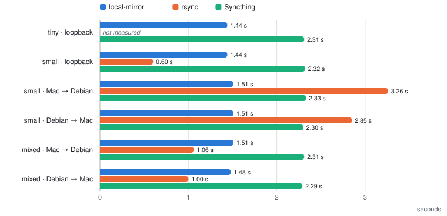
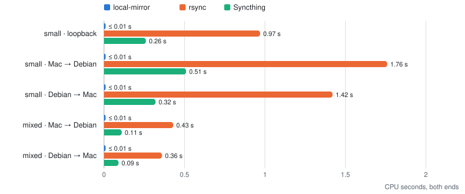
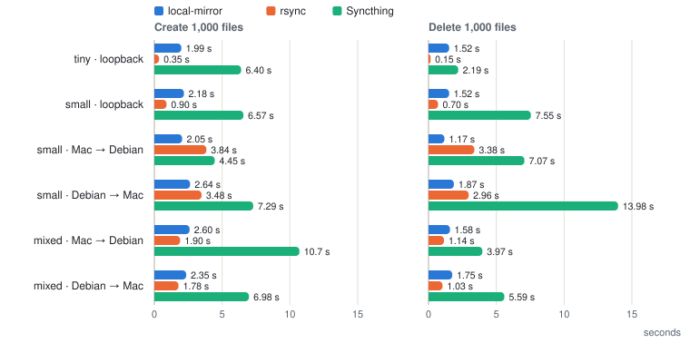
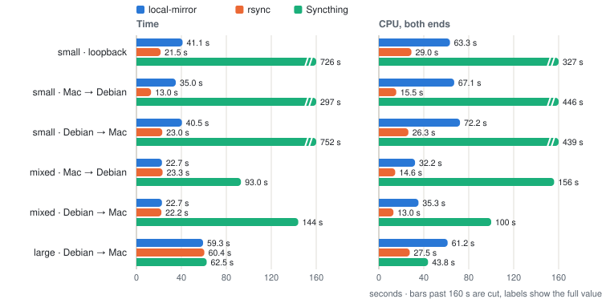

# local-mirror

<p align="center">
  <picture>
    <source media="(prefers-color-scheme: dark)" srcset="assets/wordmark-dark.svg">
    
  </picture>
</p>

English | [简体中文](README.zh-CN.md)

One-way directory mirror over TCP. One end is the **source** (`--send`), the
other keeps a live replica as the **sink** (`--receive`). Give one process both
flags to relay (A → B → C).

```
┌─────────────┐   tree / changes / files   ┌─────────────┐
│    source   │ ─────────────────────────▶ │     sink    │
│   --send    │             TCP            │  --receive  │
└─────────────┘                            └─────────────┘
 watches the fs                             pulls, stays in sync
```

## Performance

local-mirror was compared with rsync and Syncthing on four generated datasets, over
a LAN and on a single machine. All values in charts and tables are medians; LAN
results come from 3 rounds per scenario, single-machine rounds are noted with each
table. The full report, with method, per-round results and raw data, is in
[bench/results/2026-10](bench/results/2026-10/README.md) (Chinese).

- **Machines**: MacBook Air, Apple M4, APFS, Wi-Fi 6; Debian 13 mini PC, Intel N100,
  ext4, 2.5 GbE. Measured LAN throughput about 800 Mbit/s.
- **rsync**: `rsync -a --delete`, over ssh between machines, run once immediately
  after each change. The interval before cron or a person would run it is not
  included.
- **Syncthing**: send-only to receive-only, `fsWatcherDelayS=1` (the minimum);
  "Syncthing (default)" keeps the default of 10 s.
- **Single change**: 30 per round, cycling create, modify and delete of a 1–16 KiB
  file; timed from the end of the write on the source until the sink holds the
  same content.
- **CPU**: both ends combined. The sampling resolution is 0.01 s.
- **Labels**: `loopback` runs both ends on the Mac; `Mac → Debian` and
  `Debian → Mac` run over the LAN, source first.
- **local-mirror version**: v2.12.0 (`b44f192` for small, same sync code), tiny
  `2951137`. The first sync of v2.12.1 is compared at the end of this section.

### Single change

Time from the end of a write on the source until the sink holds the same content
(p50), and the CPU each change costs on both ends together.

<picture>
  <source media="(prefers-color-scheme: dark)" srcset="assets/bench/change-latency-dark.svg">
  
</picture>

<picture>
  <source media="(prefers-color-scheme: dark)" srcset="assets/bench/change-cpu-dark.svg">
  
</picture>

### Create and delete 1,000 files

<picture>
  <source media="(prefers-color-scheme: dark)" srcset="assets/bench/burst-dark.svg">
  
</picture>

### First sync

<picture>
  <source media="(prefers-color-scheme: dark)" srcset="assets/bench/first-sync-dark.svg">
  
</picture>

Mac → Debian times for large are not shown: they were bound by the Wi-Fi uplink,
whose throughput varied during the runs, and ranged from 44 to 228 s for the same
tool. Per-round values are in the report.

<details>
<summary>Full tables</summary>

#### LAN, Mac ↔ Debian

Each cell is Mac → Debian / Debian → Mac. local-mirror v2.12.0 (small: `b44f192`,
same sync code).

**small**: 100,000 files, 1–16 KiB, 5,000 directories, 0.81 GiB

| | local-mirror | rsync | Syncthing |
|---|---|---|---|
| First sync | 35.0 / 40.5 s | 13.0 / 23.0 s | 297 / 752 s |
| First sync, CPU | 67.1 / 72.2 s | 15.5 / 26.3 s | 446 / 439 s |
| Single change, p50 | 1.51 / 1.51 s | 3.26 / 2.85 s | 2.33 / 2.30 s |
| Single change, p90 | 1.85 / 1.84 s | 3.48 / 3.07 s | 2.40 / 2.38 s |
| Single change, CPU | 0.01 / 0.01 s | 1.76 / 1.42 s | 0.51 / 0.32 s |
| Create 1,000 files | 2.05 / 2.64 s | 3.84 / 3.48 s | 4.45 / 7.29 s |
| Delete 1,000 files | 1.17 / 1.87 s | 3.38 / 2.96 s | 7.07 / 13.98 s |

**mixed**: 20,000 files, log-normal sizes (median 16 KiB, max 64 MiB), 1.47 GiB

| | local-mirror | rsync | Syncthing |
|---|---|---|---|
| First sync | 22.7 / 22.7 s | 23.3 / 22.2 s | 93.0 / 144 s |
| First sync, CPU | 32.2 / 35.3 s | 14.6 / 13.0 s | 156 / 100 s |
| Single change, p50 | 1.51 / 1.48 s | 1.06 / 1.00 s | 2.31 / 2.29 s |
| Single change, p90 | 1.78 / 1.83 s | 1.17 / 1.06 s | 2.39 / 2.37 s |
| Single change, CPU | 0.01 / 0.01 s | 0.43 / 0.36 s | 0.11 / 0.09 s |
| Create 1,000 files | 2.60 / 2.35 s | 1.90 / 1.78 s | 10.7 / 6.98 s |
| Delete 1,000 files | 1.58 / 1.75 s | 1.14 / 1.03 s | 3.97 / 5.59 s |

**large**: 4 files of 1 GiB, first sync only

| | local-mirror | rsync | Syncthing |
|---|---|---|---|
| First sync, Debian → Mac | 59.3 s | 60.4 s | 62.5 s |
| First sync CPU, Debian → Mac | 61.2 s | 27.5 s | 43.8 s |
| First sync CPU, Mac → Debian | 61.3 s | 29.8 s | 49.2 s |

#### Single machine (Mac, loopback)

rsync copies locally without ssh. local-mirror `b44f192`, 1 round (30 changes); its
idle figure is from `b394743`. rsync and Syncthing: 3 rounds, measured earlier on
the same machine and dataset.

**small**

| | local-mirror | rsync | Syncthing | Syncthing (default) |
|---|---|---|---|---|
| First sync | 41.1 s | 21.5 s | 726 s | 693 s |
| First sync, CPU | 63.3 s | 29.0 s | 327 s | 317 s |
| Single change, p50 | 1.44 s | 0.60 s | 2.32 s | 7.72 s |
| Single change, CPU | 0.01 s | 0.97 s | 0.26 s | 0.47 s |
| Create 1,000 files | 2.18 s | 0.90 s | 6.57 s | 11.6 s |
| Delete 1,000 files | 1.52 s | 0.70 s | 7.55 s | 16.7 s |
| Idle 5 min, CPU | 0.04 s | 1.01 s per no-op run | 0.41 s | 9.90 s |

**tiny**: 500 files, 1–16 KiB, 25 directories. local-mirror `2951137`. Single change:
30 changes per tool; create and delete: 3 rounds.

| | local-mirror | rsync | Syncthing | Syncthing (default) |
|---|---|---|---|---|
| Single change, p50 | 1.44 s | not measured | 2.31 s | 7.74 s |
| Create 1,000 files | 1.99 s | 0.35 s | 6.40 s | 11.3 s |
| Delete 1,000 files | 1.52 s | 0.15 s | 2.19 s | 13.2 s |

</details>

### First sync in v2.12.1

v2.12.1 reduced the per-file cost of the first sync. small, Mac loopback, 3 rounds
each, alternating old and new builds:

<picture>
  <source media="(prefers-color-scheme: dark)" srcset="assets/bench/first-sync-v2.12.1-dark.svg">
  
</picture>

The LAN results above were measured before this release.

## Install

```bash
# Linux (any distro)
curl -fsSL https://raw.githubusercontent.com/xwvike/local-mirror/main/install.sh | sh

# macOS
brew install xwvike/tap/local-mirror

# Windows (Scoop; run `irm get.scoop.sh | iex` first if Scoop is not installed)
scoop bucket add xwvike https://github.com/xwvike/scoop-bucket
scoop install local-mirror

# from source
go build -o local-mirror ./cmd/local-mirror
```

## Recipes

Pairings run in the foreground. Once verified, each can be installed as a service
with the same options, as described in
[Running as a service](#running-as-a-service-recommended).

```bash
# ── 1. LAN: the source listens, the sink dials it ─────────────────────────────
# A (source). --gen-key creates a key, or reuses an existing one, and prints the
# command for B.
local-mirror --send -p /path/to/source --gen-key
# B (sink). 192.168.1.100 is the address of A.
local-mirror --receive --connect 192.168.1.100 -p /path/to/replica -k <printed-key>

# ── 2. LAN, zero config: the sink finds the source by UDP discovery ───────────
# A (source).
local-mirror --send -p /path/to/source --gen-key
# B (sink). Scans the LAN for sources and prompts for a selection.
local-mirror --receive -p /path/to/replica -k <printed-key>

# ── 3. Push over the internet: the reachable end (sink) listens ───────────────
# VPS (sink).
local-mirror --receive --listen -p /srv/backup --allow-delete --gen-key
# Client (source).
local-mirror --send --connect vps.example.net:52345 -p /path/to/source -k <printed-key>

# ── 4. Internet push, rsync-style positional form (./dir @host = push) ────────
# VPS (sink).
local-mirror --receive --listen -p /srv/backup --allow-delete --gen-key
# Client (source).
local-mirror -k <printed-key> ./path/to/source @vps.example.net:52345

# ── 5. Relay A → B → C: B pulls from A and serves C ───────────────────────────
# A (source, 192.168.1.100).
local-mirror --send -p /path/to/source --gen-key
# B (relay, 192.168.1.101).
local-mirror --send --receive --connect 192.168.1.100 -p /path/to/relay -k <printed-key>
# C (sink).
local-mirror --receive --connect 192.168.1.101 -p /path/to/replica -k <printed-key>
```

Each end stores the key in its own `.local-mirror/key` on the first run, after which
`-k` can be omitted. Running a `--gen-key` command again reuses the existing key.

## Running as a service (recommended)

local-mirror is designed to run continuously in the background and keep the replica
current; one-off copies are better served by rsync. A pairing from
[Recipes](#recipes) is first verified in the foreground, then installed as a service
with the same options: `sudo local-mirror service install <options>` on Linux, or
`local-mirror service install <options>` on macOS (a per-user service, no `sudo`).
The service starts at boot and is restarted after a failure.

Example: a Linux server receives, a Mac sends.

```bash
# ── Server: Linux, receiver, reachable as vps.example.net ─────────────────────
# Foreground run. --gen-key creates a key and prints the command for the sender.
local-mirror --receive --listen -p /srv/backup --allow-delete --gen-key
# After stopping it with Ctrl+C: install as a service. The existing key is reused.
sudo local-mirror service install --receive --listen -p /srv/backup --allow-delete --gen-key

# ── Client: macOS, sender ─────────────────────────────────────────────────────
# Foreground run.
local-mirror --send --connect vps.example.net:52345 -p ~/projects -k <printed-key>
# After stopping it with Ctrl+C: install as a service.
local-mirror service install --send --connect vps.example.net:52345 -p ~/projects -k <printed-key>
```

Service management on the Linux server. On macOS, `sudo` is omitted, the config file
is `~/.config/local-mirror/config.yml` and the log is `~/Library/Logs/local-mirror.log`.

```bash
# Config file, tasks, service state and management commands.
local-mirror service status
# Changes a directory's options by installing it again (here: deletion turned off).
sudo local-mirror service install --receive --listen -p /srv/backup --gen-key
# Applies a manually edited config. A config with errors is rejected and the
# running service is not affected.
sudoedit /etc/local-mirror/config.yml
sudo local-mirror service restart
# Removes one directory. Removing the last one stops and uninstalls the service.
sudo local-mirror service remove -p /srv/backup
# Stops and uninstalls the service. The config file is kept.
sudo local-mirror service uninstall
# Sync status and service log.
local-mirror --status --all
sudo journalctl -u local-mirror
```

Installing another directory adds a task to the same service.

## Flags

| Flag | Description | Default |
|---|---|---|
| `--send` | this end is the source: data flows out | |
| `--receive` | this end is the sink: data flows in (both = relay) | |
| `--connect` | dial the peer at `host[:port]`; the peer must be listening | |
| `--listen` | wait for the peer to dial in | |
| `-p, --path` | sync root; state lives in `.local-mirror/` beneath it | working dir |
| `-a, --alias` | instance name shown in discovery lists | hostname |
| `-i, --ignore` | extra ignore patterns, comma-separated | |
| `--config` | YAML config file (mutually exclusive with the other flags) | |
| `--allow-delete` | delete sink files that no longer exist upstream | off |
| `--allow-critical` | allow syncing on critical paths, with overwrite backups | off |
| `-k, --secret` | transport encryption key (or `secret:` in the YAML config) | |
| `--gen-key` | write a random key to `.local-mirror/key` (reuses an existing one) and print it; with run flags, start as well | |
| `--show-key` | print the existing key file and exit | |
| `--no-encrypt` | force plaintext even when a key file exists | |
| `--status` | print a running instance's status and exit (`--all` for every one) | |
| `--heat` | print a running source's directory heat table and exit | |
| `-c, --cooldown` | full-rescan interval in seconds, sink side | `1800` |
| `-f, --filebuffersize` | transfer chunk size in bytes, source side | `65536` |
| `-l, --loglevel` | `debug` / `info` / `warn` / `error` | `error` |


## Direction & transport

Two independent axes: **direction** (`--send` / `--receive`) and **transport**
(`--connect` / `--listen`). Combine freely.

- `--connect` takes a domain, IPv4, or IPv6 literal, with an optional port (`--connect [2001:db8::1]:52345`).
- `--receive` without `--connect` or `--listen` performs LAN discovery: it scans over UDP and prompts for a source (recipe 2).
- A listening sink serves one source at a time. A source connecting during an active session is rejected and retries with backoff.

## Ignore patterns

Patterns come from `-i` and/or a `.local-mirror/ignore` file (one per line, `#`
comments). There are two forms:

- **A name without a slash** matches that path segment at any depth: `node_modules`
  excludes every directory with that name, wherever it sits. A trailing slash is
  allowed and changes nothing (`target/` is the same as `target`).
- **A pattern containing a slash** is matched against the path, anchored at the sync
  root: `src-tauri/target` excludes only that one subtree, not same-named
  directories elsewhere. A leading slash is optional, and `**` spans any number of
  segments, so `**/src-tauri/target` matches at any depth.

`* ? []` globs apply within a segment (`*.log`, `packages/*/dist`). Matching a
directory covers its whole subtree. Matching is case-sensitive.

- On the source, a match is never scanned or served (enumeration and direct file
  requests both refused), and the sink never deletes its own copy of it: a path
  the source ignores is missing upstream because it is ignored, not because it was
  deleted. On the sink, never downloaded and never deleted. Either way, adding a
  pattern later does not remove what the sink already has.
- Sinks older than v2.10.2 do not know the source's ignores: with `--allow-delete`
  they delete their own copies of whatever the source ignores (including the
  default ignores below, new in v2.10). **Upgrade sinks before sources.** The
  source logs a warning when an older sink connects.
- `.local-mirror` (own state dir) is always excluded and cannot be un-ignored.

### Default ignores

Build output and dependency directories that a project regenerates, and that often
bake in absolute paths from the machine that produced them:

| Ecosystem | Excluded by default |
| --- | --- |
| JS/TS | `node_modules`, `.next`, `.nuxt`, `.svelte-kit`, `.turbo`, `.vite` |
| Rust, Maven, Gradle | `target`, `.gradle` |
| Python | `__pycache__`, `.venv`, `venv`, `.pytest_cache`, `.mypy_cache`, `.ruff_cache` |
| macOS | `.DS_Store` |

A `!` prefix syncs one anyway: `-i '!node_modules'`. Go has no conventional output
directory, so nothing is excluded for it.

`dist`, `build`, `out`, `vendor` and `Pods` are deliberately **not** default
ignores: they are often committed on purpose, and excluding them by default would
silently drop files. Add them yourself when they apply: `-i 'dist,build'`.

`.git` **is** synced. That carries history, branches, remotes and your uncommitted
work, which `git clone` cannot. The cost is that copying a live version-control
database can capture an inconsistent moment, so avoid running git commands on the
source while the first push runs, and check afterwards:

```bash
find <dir> -maxdepth 2 -name .git | while read -r g; do
  r=$(dirname "$g"); LC_ALL=C git -C "$r" fsck --no-dangling | grep -v '^notice:' \
    && echo "$r needs attention"
done
```

Dangling objects are normal. A clean `git status` is the strong signal: it means
every tracked file's hash matches what `.git` records. To exclude `.git` instead,
use `-i '.git'`.

## What gets synced

- Regular files (content and modification time) and directories, plus the
  permission bits (`rwx`) of both. Sink directories always keep owner `rwx`.
  Permissions are not synced to or from Windows.
- Symlinks, sockets, FIFOs and device files are skipped.
- Anything the source cannot read (a file or a whole directory) is skipped, and the
  sink leaves its copy untouched, even with `--allow-delete`. Sync resumes once it
  is readable again.
- Permissions changed locally on a sink are restored on its periodic local rescan.

## First sync

A receiver that has not completed its first sync receives the whole tree from the source
in one continuous stream, without a request per file or per directory. On a
long-distance link this removes most of the time a first sync of many small files takes.

- Files already in the target directory do not prevent the first sync. A file at the
  same path as a source file is overwritten; a file the source does not have is kept,
  or deleted with `--allow-delete`.
- An interrupted first sync continues from the last recorded entry on the next
  connection. A partly received file resumes where it stopped.
- The progress is recorded in `.local-mirror`. Deleting that directory or changing the
  sync root starts a new first sync of the whole tree.
- With a peer that does not support it, the first sync runs file by file.

## Deletion safety

Syncing overwrites existing files; `--allow-delete` removes extra ones. Three
levels, by sync root:

| Root | no flag | `--allow-critical` | `--allow-critical` + `--allow-delete` | `--allow-delete` only |
|---|---|---|---|---|
| normal | sync, no delete | same | sync + delete | sync + delete |
| **critical** | **refused** | sync + overwrite backup | sync + delete + overwrite backup | **refused** |

Critical = home directory, filesystem roots, system trees (`/etc`, `/usr`, …)
including subdirectories; resolved through symlinks first. Backups land in
`.local-mirror/backups/<relative path>` before the first overwrite.

## Encryption

Noise protocol (NNpsk0). Same `-k` passphrase on both ends → mutual auth and
forward secrecy; a wrong key or a plaintext peer fails the handshake.

- **A listener binds all interfaces, so a plaintext listener refuses to start.**
  Any non-loopback listener must set a key, or pass `--no-encrypt` to insist on
  plaintext (trusted LAN only). Dialers are unaffected.
- `--gen-key` writes a random key to `.local-mirror/key` (mode 600). On a terminal
  it also prints the key and the command for the other end. An existing key file
  is reused, so the same command can be run again after a restart. Combined with
  run flags, it starts the instance in the same command. A self-chosen key should
  be a long random string (`openssl rand -base64 24`).
- Resolution order: explicit `-k` (or `secret:` in YAML) > `.local-mirror/key`
  file > plaintext. An end started with `-k` saves the key to its own key file
  (sinks, and sources that dial out), so later runs can omit `-k`.
- `local-mirror --show-key -p <dir>` prints the key (on a terminal only);
  `local-mirror --gen-key --force -p <dir>` generates a new one. Regenerating the
  key on the listening end disconnects every connected dialer.

## Observe: `--status` / `--heat`

When local-mirror runs in the foreground in a terminal, the link, the current
transfer, the session totals, the error count and the latest log lines are shown
below the start-up banner and refreshed every second. While this display is active,
logs are written only to the log file. It is not shown when the output is redirected
or when local-mirror runs as a service.

Read-only commands for a running instance, selected by `-p` (its sync root) or by
the current directory. The daemon writes `status.json` / `heat.json` only while
one of these commands is running.

```bash
# Status of the instance whose sync root is /path/to/source.
local-mirror --status -p /path/to/source
# Status of every instance on this host.
local-mirror --status --all
# Directory heat table of a source (sinks have none).
local-mirror --heat -p /path/to/source
```

`--all` finds every instance on this host from the process table. On macOS it only
finds instances started with absolute paths.

```
──────────────────────────────────────────────────────
  Status      ● running   pid 62289 · up 3h12m
  Direction   send · source   (listen)
  Listen      IPv4 + IPv6   (0.0.0.0:52345)
  Link        ● serving 192.168.1.50:54012
  Encryption  on (Noise NNpsk0)
  Transfer    ▶ docs/report.pdf  ██████████░░░░░░  4.2 MB / 8.1 MB  5.3 MB/s
  Totals      1.2 GB / 3841 files    Errors 0
──────────────────────────────────────────────────────
```

The `Listen` row names the address families that are **still accepting**. A socket
can stay bound while the process has stopped accepting on it: the kernel completes
the TCP handshake anyway, so an outside port probe reports the port as open while
every client connects and then waits for a reply that never comes. When that
happens, the row says so:

```
  Listen      IPv4 + IPv6 not accepting   (0.0.0.0:52345)   ← that address family is bound but unserved
```

The foreground status area shows the same row.

`--heat`: a source scores each directory by activity, watches hot ones in real
time (tier1) and polls cold ones lazily (tier2). The table lists directories
hottest first and shows whether active directories are watched in real time.
On macOS file events come from FSEvents, which watches the whole tree at no
per-directory cost, so every directory is in tier1; the split matters on Linux,
where real-time watches are capped by `fs.inotify.max_user_watches`.

## Service details

`local-mirror service install` keeps its tasks in a YAML config: `/etc/local-mirror/config.yml`
for a system service (Linux default) or `~/.config/local-mirror/config.yml` for a
per-user one (macOS default). The file can also be edited manually;
`sudo local-mirror service restart` (Linux) or `local-mirror service restart`
(macOS) applies the changes. Example:
[deploy/local-mirror.example.yml](deploy/local-mirror.example.yml).

```yaml
defaults:
  loglevel: info
  secret: <key>           # listening tasks need a key (or a .local-mirror/key in their root)
tasks:
  - name: photos          # task name = discovery alias = log prefix
    send: true
    path: /srv/photos
    ignore: [cache, "*.log"]
  - name: nas-backup
    receive: true
    connect: 192.168.1.100
    path: /srv/backup
    allow_delete: true
```

- Each task takes the same direction keys as the CLI (`send` / `receive` /
  `connect` / `listen`; both `send` and `receive` = relay). One task runs
  in-process; two or more each get a child process (crash → restart with backoff;
  config error = exit 2, stops only that task). Listening tasks share ports
  52345–52354 (ten max).
- The key lives in the config's `secret:` (mode 0600, readable only by the service
  user), never on a command line where `ps` would show it. **The config file must
  not live inside any task's sync root** (it would be mirrored out, secret and
  all); local-mirror refuses such a config.
- On Linux the service runs as the user who invoked `sudo`, not as root, so synced
  files are not owned by root. Another account is set with
  `sudo local-mirror service install --run-as <user> <options>`.
- The scope follows the platform default (Linux: system, macOS: per-user); every
  service command accepts `--system` or `--user` to override it.
- Init systems are detected automatically: **systemd**, **launchd**, **procd**
  (OpenWrt: `/etc/init.d/local-mirror`, output to `logread`).
- `local-mirror service install --dry-run <options>` prints the files and commands it
  would write and run, without changing the system.
- The same config also runs in the foreground: `local-mirror --config <file>`.

## Files under `.local-mirror/`

In the sync root, excluded from syncing and from git:

| File | Purpose |
|---|---|
| `cache.db` | persisted directory tree; restarts skip unchanged files |
| `key` | self-managed transport key (mode 600), auto-loaded when `-k` omitted |
| `status.json` | live status, written only while `--status` watches; discardable |
| `heat.json` | heat table, written only while `--heat` watches (source); discardable |
| `logs/error.log` | runtime log, rotated at 10 MB, keeps last 3 |
| `partial/` | chunks of interrupted downloads awaiting resume |
| `backups/` | pre-overwrite copies, only with `--allow-critical` |
| `ignore` | optional ignore patterns, merged with `-i` (restart to apply) |

## Development

```bash
go build ./...
go test ./...
```

Releases are cut by pushing a `v*` tag: CI runs goreleaser, publishing the
archives, the Homebrew cask and the Scoop manifest in one go
(`goreleaser release --snapshot --clean` builds locally without publishing).

MIT licensed.
